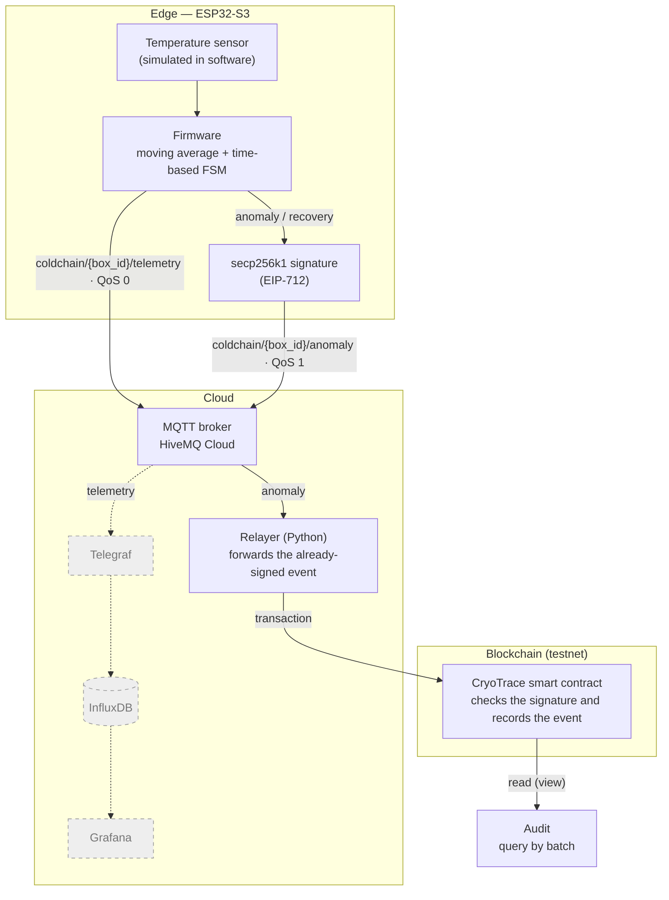

# CryoTrace

Vaccine cold-chain traceability with edge computing and selective anchoring on a blockchain.

Each thermal shipping box carries a vaccine batch and an ESP32-S3 that monitors its temperature. The ESP32 detects locally when the temperature leaves the allowed range (2–8 °C) and when it comes back, **signs these events with its own key**, and publishes them over MQTT. A relayer takes the signed events to a smart contract, which accepts them only if the signature belongs to the registered box. Pharmacies and regulators can then audit a batch's history without trusting any intermediary, and only relevant events go on-chain — not every reading.

> Final project for **IA376 — Topics in Computer Engineering VII (Edge Computing)**, FEEC/Unicamp, 2026s2, Prof. Jonas Queiroz.
> Author: João Batista Serino Dantas.

## Architecture



Dashed blocks are out of the implementation scope: the ESP32 publishes telemetry, but the Telegraf → InfluxDB → Grafana path exists only in the design.

**Key ideas:**

- **Decision at the edge:** moving-average filter + time-based state machine. The box enters ANOMALY after 3 s continuously out of range and returns to NORMAL after 3 s continuously back in range. A sensor read failure is also an anomaly.
- **Selective anchoring:** only anomaly and recovery events go on-chain. The recovery event gives the total thermal exposure time.
- **Signing at the source:** the ESP32 itself signs each event (EIP-712, secp256k1). The relayer can delay an event, but cannot forge or alter it.
- **Works offline:** signing does not depend on the network and signatures never expire; events buffered during a connection loss can be submitted later, in any order.
- **Own connectivity:** the box connects through its own cellular modem (NB-IoT / LTE-M), so it does not depend on the vehicle's network. The prototype can use Wi-Fi instead (e.g. a phone hotspot).

## Status

| Part | Status |
|---|---|
| Filter + anomaly/recovery FSM | ✅ implemented and tested on the host |
| Simulated sensor (120 s test profile) | ✅ |
| Wi-Fi link + time sync (NTP) | ✅ builds; still to be validated on the board |
| Cellular link: NB-IoT / LTE-M (SIM7080G via esp_modem) | ✅ builds; not tested (no modem available) |
| Smart contract + tests | ✅ 20 tests (Foundry) |
| EIP-712 encoding + firmware signing | ✅ verified byte for byte against the contract |
| FSM events signed and serialized as the MQTT payload | ✅ tested on the host |
| Device key generated on-chip + persistent counter (NVS) | ✅ builds; still to be validated on the board |
| MQTT publishing over TLS (HiveMQ Cloud) | ⏳ |
| Python relayer | ✅ tested end to end against a local chain (anvil) |
| Deploy and provisioning scripts (Foundry) | ✅ tested on a local chain |
| Testnet deployment (Sepolia) and end-to-end test | ⏳ |
| Physical sensor / hardware simulation | ⏳ (last) |
| Telegraf → InfluxDB → Grafana | out of scope |

## Repository layout

```
main/                       ESP-IDF firmware (ESP32-S3)
  main.c                    Monitoring and publishing loop
  Kconfig.projbuild         menuconfig options (range, timings, IDs, network, contract)
  sensor/
    sensor.c/.h             Sensor reading (simulated for now)
    sensor_sim.c/.h         Simulated temperature profile
  monitoring/
    filter.c/.h             Moving average
    fsm.c/.h                NORMAL ⇄ ANOMALY state machine
  signing/
    signed_event.c/.h       EIP-712 encoding and secp256k1 signing
    event_payload.c/.h      FSM event -> signed event -> MQTT JSON payload
    device_identity.c/.h    Device key and event counter in NVS
  network/
    network.c/.h            Network start + SNTP
    network_wifi.c          Wi-Fi link
    network_cellular.c      Cellular link (NB-IoT / LTE-M modem over PPP)
components/trezor_crypto/   trezor-crypto subset (MIT): secp256k1 and Keccak
contracts/                  Foundry project
  src/CryoTrace.sol         Smart contract
  test/                     Contract tests and the vector shared with the firmware
test/host/                  Firmware tests in C, running on the PC (gcc)
relayer/                    Python relayer: MQTT -> recordEvent (see relayer/README.md)
```

## Build and test

### Firmware tests on the PC

No board or ESP-IDF needed, just `gcc` and `make` (Linux).

```sh
make -C test/host
```

Runs the FSM and filter tests (including a full cycle of the simulated sensor) and the signing tests, which check that the C code produces exactly the hash and signature the contract expects.

### Smart contract

Requires [Foundry](https://book.getfoundry.sh/getting-started/installation).

```sh
cd contracts
forge install foundry-rs/forge-std --no-git
forge install OpenZeppelin/openzeppelin-contracts@v5.1.0 --no-git
forge test               # all tests
forge test --gas-report  # gas cost per function
```

### Relayer

Requires Python 3.10+; the end-to-end tests also need Foundry (`anvil`).

```sh
cd relayer
python3 -m venv .venv
.venv/bin/pip install -r requirements.txt -r requirements-dev.txt
.venv/bin/python -m pytest
```

Configuration and how to run it against HiveMQ and Sepolia: [relayer/README.md](relayer/README.md).

### Firmware (ESP32-S3)

Requires [ESP-IDF](https://docs.espressif.com/projects/esp-idf/en/latest/esp32s3/get-started/) v6.1.

```sh
. $IDF_PATH/export.sh
idf.py set-target esp32s3
idf.py menuconfig        # "CryoTrace", "CryoTrace - Network", "CryoTrace - Blockchain"
idf.py build flash monitor
```

In menuconfig:

- **CryoTrace:** box and batch IDs, temperature range (in tenths of °C), anomaly enter/exit times, sampling period, filter window and telemetry period.
- **CryoTrace - Network:** the network link, plus the NTP server. Credentials are stored in `sdkconfig`, which is not committed.
  - **Wi-Fi** (default): SSID and password. With no SSID, monitoring still runs, just without network.
  - **Cellular modem:** a SIMCom SIM7080G on a UART, driven by [esp_modem](https://components.espressif.com/components/espressif/esp_modem) as a PPP interface (MQTT, TLS and NTP run on top unchanged). Options: radio technology (NB-IoT, LTE-M or automatic), APN, SIM PIN, UART TX/RX pins and baud rate, and an optional PWRKEY GPIO to power the modem on.
- **CryoTrace - Blockchain:** chain ID (default 11155111, Sepolia) and the deployed contract address, which together form the EIP-712 domain.

On first boot the device generates its secp256k1 key from the hardware RNG, stores it in NVS and logs its Ethereum address (`device address (register in the contract): 0x...`). That address is what gets registered for the box in the contract.

Each anomaly/recovery is published on `coldchain/{box_id}/anomaly` as:

```json
{"boxId":"0x8c4d…","batchId":"0x36c5…","kind":1,"anomalyType":1,
 "startTime":1767225600000,"endTime":1767225615000,"temperature":790,
 "peak":1121,"counter":42,"signature":"0x08a7…1c"}
```

## Signed event

The ESP32 signs, following [EIP-712](https://eips.ethereum.org/EIPS/eip-712), the struct:

```
ColdChainEvent(bytes32 boxId, bytes32 batchId, uint8 kind, uint8 anomalyType,
               uint64 startTime, uint64 endTime, int16 temperature, int16 peak,
               uint32 counter)
```

- `kind`: 0 = anomaly start, 1 = recovery
- `anomalyType`: 0 = below range, 1 = above range, 2 = no sensor reading
- times in epoch ms; temperatures in °C × 100
- domain: name `CryoTrace`, version `1`, `chainId` and contract address (a signature is not valid on another network or contract)

The contract is in [contracts/src/CryoTrace.sol](contracts/src/CryoTrace.sol) and the firmware side in [main/signing/signed_event.c](main/signing/signed_event.c).

## Credits

- [trezor-crypto](https://github.com/trezor/trezor-firmware/tree/main/crypto) (MIT) — secp256k1 and Keccak in the firmware; see [components/trezor_crypto/README.md](components/trezor_crypto/README.md).
- [OpenZeppelin Contracts](https://github.com/OpenZeppelin/openzeppelin-contracts) (MIT) — EIP-712, ECDSA and access control in the contract.
